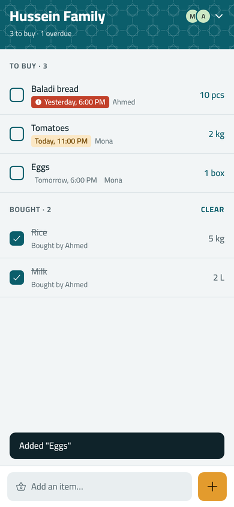
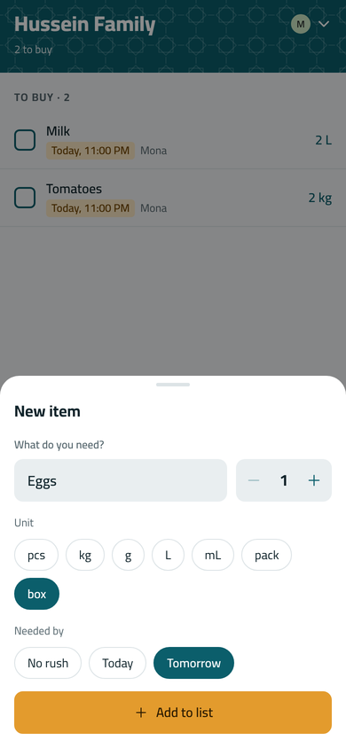
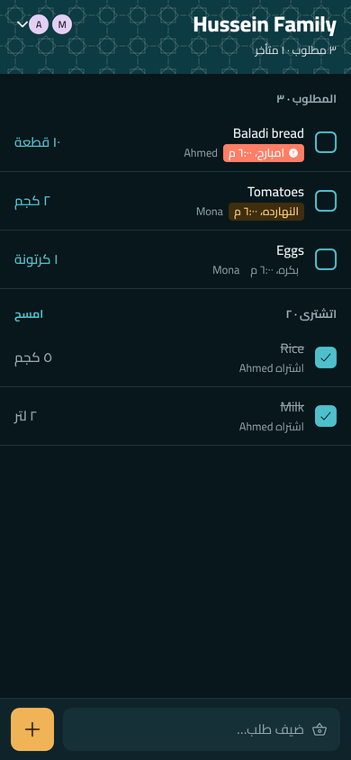
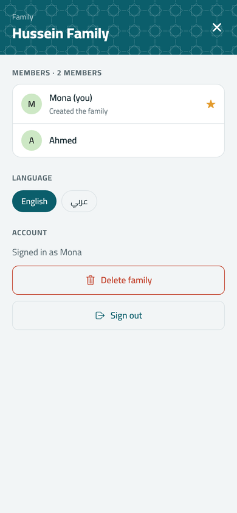

# Talabat ElBeit · طلبات البيت

A shared shopping list for the whole family, in Arabic and English. Built with Expo (React Native) and Firebase.

<p>
  
  
  
  
</p>

## What it does

- **One list per family.** Everyone sees changes live: items, who added them, who bought them.
- **Quick adding.** Name, quantity, unit (pcs, kg, g, L, mL, pack, box) and an optional "needed by" time: No rush, Today, Tomorrow, or a time you pick.
- **To buy, then Bought.** Tap to mark bought. Overdue items are flagged in red. Swipe to delete, with Undo.
- **Notifications.** Other members get a push notification in their own language when you add, buy or remove something.
- **Arabic and English.** Full right-to-left layout and Arabic digits (٢ كجم).
- **Light and dark** themes, following the phone.

## Getting started

1. Install dependencies:
   ```bash
   npm install
   ```
2. Create a Firebase project. In the Firebase console:
   - **Authentication → Sign-in method:** enable **Email/Password**. Leave **Anonymous** off.
   - **Firestore:** create a database.
   - **Project settings → Your apps:** add a Web app and copy its config.
3. Copy `.env.example` to `.env.local` and fill in the values from that config.
4. Deploy the security rules (see [Security](#security)):
   ```bash
   npx firebase deploy --only firestore:rules --project YOUR_PROJECT_ID
   ```
5. Run the app:
   ```bash
   npx expo start
   ```
   Push notifications need a development build (`npx expo run:android` / `npx expo run:ios`, or EAS Build).

### Running against local emulators

No Firebase project needed:

```bash
npx firebase emulators:start --only auth,firestore --project demo-talabat
```

Then start the app with `EXPO_PUBLIC_USE_EMULATORS=1` (in `.env.local` or on the command line).

## Security

Family data is protected by [`firestore.rules`](firestore.rules), enforced by Firebase's servers. The app only displays what the rules allow.

- A family's items and members are readable only by its members.
- The family password is stored as a salted SHA-256 hash that no client can read. To join, the app records your guess first, and the rules only let you become a member if that recorded guess matches.
- Guessing is rate-limited by the rules themselves:
  - **Per account:** 5 attempts, then one every 15 minutes, then one an hour after 10.
  - **Per family:** at most 10 attempts an hour, across all accounts.
- Family passwords must be at least 8 characters.

## Tests

```bash
npm test            # unit tests: name rules, lockout maths, dates, translations, push messages
npm run test:rules  # security rules and Firestore services, against the Firestore emulator (needs Java 21)
npm run typecheck
npm run lint
```

## Project layout

```
app/                Screens (expo-router): sign-in, family-setup, index (the list), family
components/ui/      Themed building blocks: text, buttons, fields, chips, sheet, pattern band…
components/list/    List rows, add bar, add-item sheet
hooks/              Session (auth + family membership), live family data, clock
services/           Firebase setup and Firestore operations (families, items, users, push)
lib/                Pure logic with unit tests
i18n/               English and Arabic strings, language switching
theme/              Mashrabiya colors, spacing, type
firestore.rules     Server-side security rules
tests/rules/        Emulator tests for the rules and services
docs/               Design spec, implementation plan, design directions
```

## License

MIT License © 2025
